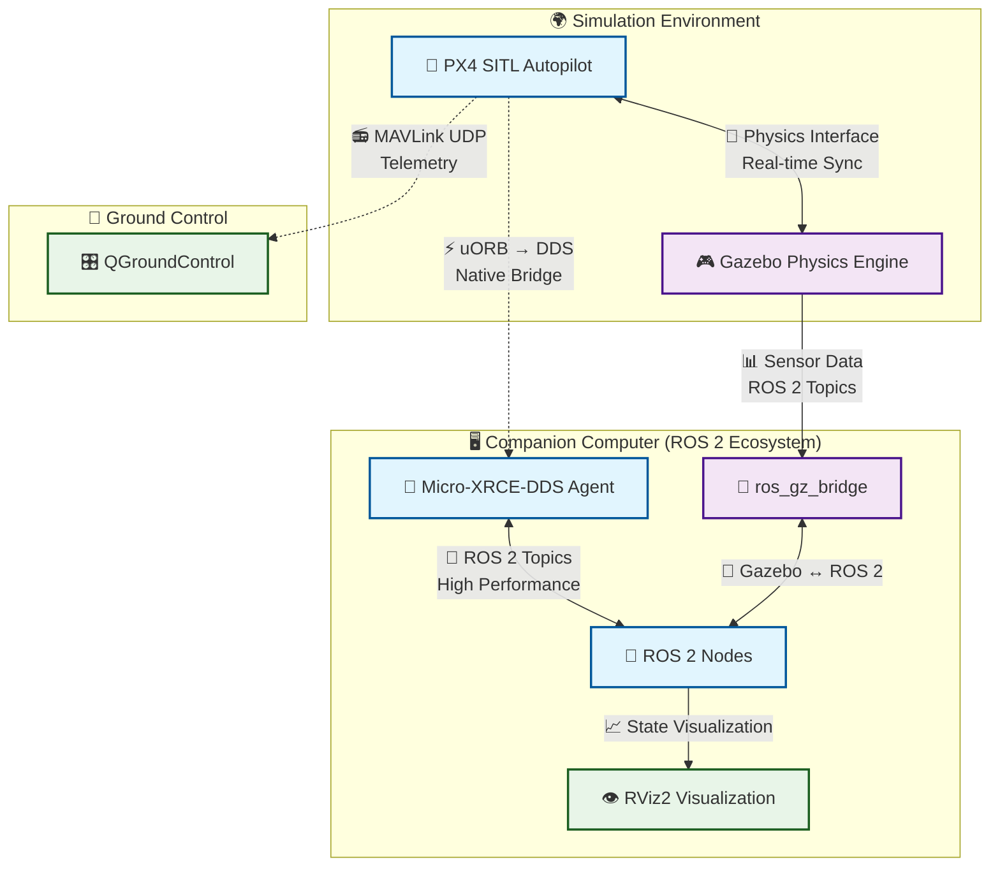
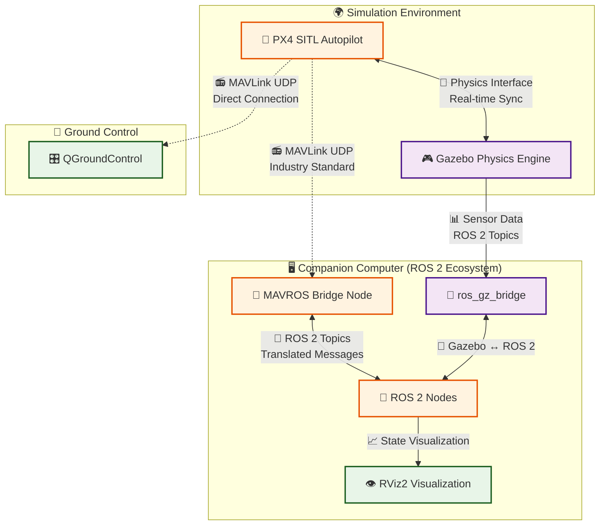

# PX4 <-> ROS 2 communication

**What `sim.launch.py` actually starts (Gazebo backend):** MAVROS, always
(namespace `/<ns>/mavros`, PX4 instance N on UDP 14540+N / 14580+N). PX4's
uXRCE-DDS client also runs inside SITL and sends to UDP port 8888 (or
`$PX4_UXRCE_DDS_PORT`), in `ROS_DOMAIN_ID`, under the `<ns>` namespace, but
the launch does not start an agent: run `MicroXRCEAgent udp4 -p 8888` (the
Docker image ships it) and build `px4_msgs` matching PX4 v1.15 to use the
native topics. The sections below compare the two paths.

This simulation environment supports **two distinct communication architectures** that allow ROS 2 to interface with PX4. Each has its own advantages and use cases, giving you the flexibility to choose the best approach for your specific needs.

---

### 🚀 Architecture 1: Native PX4-ROS 2 Bridge (uXRCE-DDS)

<strong>Modern • Official • High Performance</strong>

**Overview:** This is the **modern, official, and recommended** architecture by the PX4 development team for ROS 2 integration. It provides the highest performance by connecting directly to PX4's internal uORB messaging system.

#### 🔧 How It Works
- **Bridge Component**: A lightweight `uxrce_dds_client` runs directly on PX4
- **Communication**: Talks to a `Micro-XRCE-DDS Agent` on the companion computer
- **Protocol**: Directly translates PX4's internal uORB messages to/from DDS standard
- **Integration**: Makes PX4's uORB topics appear as native ROS 2 topics

#### ⚡ Key Advantages
- **High Performance**: Direct, native integration with minimal overhead
- **Low Latency**: No protocol conversion delays
- **Official Support**: Maintained by PX4 development team
- **Future-Proof**: Designed for modern ROS 2 ecosystem

---

### 🛰️ Architecture 2: Classic MAVLink Bridge (MAVROS)

<strong>Battle-Tested • Versatile • Cross-Platform</strong>

**Overview:** This is the **classic, highly mature, and versatile** architecture that has been the backbone of drone development for years. It uses MAVLink as the communication protocol, which is the industry standard for autopilot communication.

#### 🔧 How It Works
- **Bridge Component**: The `mavros` ROS 2 node runs on the companion computer
- **Communication**: PX4 communicates using the standard MAVLink protocol
- **Protocol**: MAVLink messages are translated into ROS 2 topics and services
- **Compatibility**: Works with multiple autopilots (PX4, ArduPilot, etc.)

#### 🛡️ Key Advantages
- **Battle-Tested**: Years of production use and community validation
- **Cross-Platform**: Supports multiple autopilot systems beyond PX4
- **Mature Ecosystem**: Extensive documentation and community support
- **Robust**: Well-established error handling and recovery mechanisms

---

### 🤔 Which Architecture Should You Choose?

| Criteria | uXRCE-DDS | MAVROS/MAVLink |
|----------|-----------|-----------------|
| **Performance** | ⭐⭐⭐⭐⭐ Highest | ⭐⭐⭐⭐ High |
| **Latency** | ⭐⭐⭐⭐⭐ Minimal | ⭐⭐⭐ Low |
| **Maturity** | ⭐⭐⭐ Newer | ⭐⭐⭐⭐⭐ Very Mature |
| **Community Support** | ⭐⭐⭐ Growing | ⭐⭐⭐⭐⭐ Extensive |
| **Cross-Platform** | ⭐⭐ PX4 Focused | ⭐⭐⭐⭐⭐ Universal |
| **Future-Proof** | ⭐⭐⭐⭐⭐ Yes | ⭐⭐⭐⭐ Established |

#### 💡 Recommendations

**Choose uXRCE-DDS if:**
- You're building new applications with PX4
- Performance and latency are critical
- You want the latest, official integration approach
- You're working primarily with PX4 autopilots

**Choose MAVROS/MAVLink if:**
- You need maximum compatibility across different autopilots
- You're working with legacy systems or existing MAVLink infrastructure
- You prefer battle-tested, production-proven solutions
- You need extensive community support and documentation

---

### 🔧 Implementation Notes

Both architectures are **fully supported** in this simulation environment:

- **MAVROS** is launched for you; every uavros2 node (flight aliases, `aerial_arm_demo`, the canonical topic contract) uses it.
- **uXRCE-DDS** is available alongside it: PX4's client is always running, start the agent yourself (see the top of this page).
